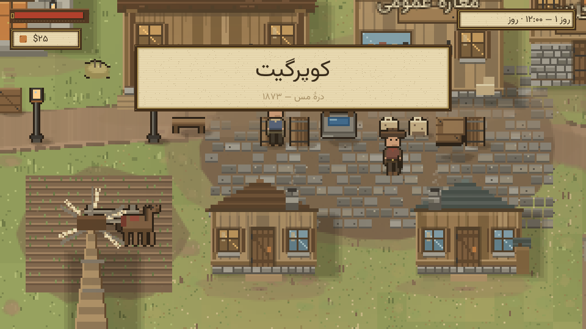

# Coppergate — دروازهٔ مسی

یک بازی **۲بعدی وسترن اکشن-ماجرایی با دنیای باز، اورجینال** که در مرورگر اجرا می‌شود. الهام طراحی: عمق سیستمی و حس «دنیای زنده» در Red Dead Redemption — بدون هیچ محتوای کپی‌شده.

> وضعیت: **فاز ۱.۵ — بازسازی کامل بصری v3** (نقشه راه کامل در `docs/DEVELOPMENT_ROADMAP.md`)



## امکانات فعلی (فاز ۱)

- دنیای کوچک اما معنادار: مسیر غربی شهر کاپرگیت — بیابان بدلندز، جادهٔ خاکی، چاه، حصار سیکارا، برکهٔ شمالی
- بازیکن «الیاس بون» با حرکت نرم (WASD/جهت‌ها)، دویدن (Shift)، برخورد صحیح با صخره/آب/حصار/ساختمان‌ها
- دوربین نرم با zoom پیکسل‌آرت و مرز دنیا
- ساعت دنیای واقعی: روز/سپیده/غروب/شب با تینت محیطی (یک روز کامل = ۱۲ دقیقه واقعی)
- NPCهای اولیه با گشت‌زنی تصادفی محدوده‌ای و انیمیشن‌های ۴ جهته
- سیستم تعامل با نزدیک‌ترین هدف: گفتگو با NPCها، تابلو، در سالون — دیالوگ فارسی با تایپ‌رایتر
- HUD فارسی: جان، پول، ساعت دنیا؛ مکث (Esc) با برگهٔ کنترل‌ها
- همهٔ اسپرایت‌ها و تایل‌ها **پروسیجرال و اورجینال** (کد تولید می‌کند؛ هیچ asset دانلودی نیست)

## کنترل‌ها

| کلید | عمل |
|---|---|
| `WASD` / کلیدهای جهت | حرکت |
| `Shift` (نگه‌داشتن) | دویدن |
| `E` | تعامل (گفتگو/بررسی) |
| `Enter` | ادامهٔ دیالوگ |
| `Esc` | مکث / ادامه |

## اجرا

```bash
npm install        # یک بار
npm run dev        # توسعه: http://localhost:5173
npm test           # تست‌های واحد (Vitest)
npm run build      # بیلد پروداکشن در dist/
npm run preview    # پیش‌نمایش بیلد: http://localhost:4173
```

نسخهٔ منتشرشده: `https://karanrzn-crypto.github.io/2DrdrGame/` (شاخهٔ `gh-pages`)

## تکنولوژی

| لایه | انتخاب | چرا |
|---|---|---|
| موتور | **Phaser 4.2.1** | آخرین نسخهٔ پایدار؛ بازنویسی‌شده با پشتیبانی بومی TypeScript؛ صحنه/فیزیک/تایل‌مپ/انیمیشن آماده |
| زبان | **TypeScript (strict)** | ایمنی معماری و refactor امن در پروژهٔ بلندمدت |
| بیلد | **Vite** | dev-server سریع، بیلد تمیز، `base: './'` سازگار با Pages |
| تست | **Vitest** | هم‌بستر با Vite؛ منطق خالص بدون نیاز به مرورگر |
| فونت | **Vazirmatn (OFL)** | متن فارسی داخل بازی؛ fallback: Tahoma |

## ساختار مخزن

```
src/
  config/    GameConfig — ثابت‌ها و پیکربندی Phaser
  core/      EventBus, GameState (تک‌منبع حقیقت), TimeSystem, format
  assets/    Palette, PixelPen, TileFactory, CharFactory, PropFactory, TileIds
  world/     MapData — دادهٔ authored نقشه + قواعد عبور
  entities/  Player, Npc
  systems/   InteractionSystem
  scenes/    BootScene, WorldScene, UIScene
  ui/        HUD, DialogueBox
  data/      Dialogues (متن فارسی)
tests/       تست‌های واحد منطق خالص
docs/        مستندات طراحی/معماری/نقشه راه/تست
```

## مجوزها و منشأ assetها

- کد: MIT
- همهٔ گرافیک‌ها: تولیدشده با کد همین پروژه (بدون منبع بیرونی)
- فونت: [Vazirmatn](https://github.com/rastikerdar/vazirmatn) — SIL OFL 1.1
- هیچ asset متعلق به بازی تجاری‌ای استفاده نشده است
